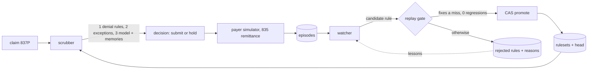

# Recursive Revenue-Cycle Harness

A claim-scrubbing agent that improves itself without weight updates. Before a healthcare claim goes out, the **scrubber** predicts whether the payer will pay or deny it and why. A second **watcher** agent mines the scrubber's misses against real adjudication outcomes (denials plus CARC codes) and proposes payer-specific rules. A **replay gate** that computes its own numbers decides which proposals become part of the scrubber. Every payer has its own hidden rulebook; the harness learns it from denials and keeps what it learned in MongoDB Atlas, so a restarted process picks up exactly where the last one left off.

Billing and coverage only, never clinical judgment. All data is synthetic, no PHI.

Built at the SF Tech Week Harness Engineering hackathon (Shack15, Oct 11 2026) by Pranav Lende, Bruce Beckley, Arjun Prasad, Xavier Huang.

## What it does in one minute
1. A claim arrives. The scrubber checks the learned rules first, then learned exceptions, and only then asks a model, which sees the payer's rules and similar past outcomes.
2. The claim is submitted to a simulated payer that returns an 835-style remittance (paid, or denied with CARC and RARC codes). Both the decision and the real outcome are stored as an episode.
3. The watcher reads the training misses and writes candidate rules in a small executable JSON rule language. It never sees the simulator's rule table or any held-out claim.
4. The gate replays each candidate against every observed training outcome. A rule is promoted only if it fixes at least one real miss and contradicts zero observed outcomes. Thresholds are pinned in `harness/gate.py`, outside anything the watcher can write.
5. Promotion appends an immutable ruleset version and moves the head with a compare-and-swap, so two writers cannot silently overwrite each other.
6. Next iteration, the scrubber uses the new ruleset. We score it on held-out claims whose outcomes it never learned from.

## Architecture


```
claim -> scrubber (rules -> exceptions -> LLM with memories) -> payer sim (835)
      -> episodes -> watcher -> gate -> CAS promote -> rulesets/head -> scrubber
```

## Landed
- [#1](https://github.com/ALLENDE123X/mongodb-memory-hackathon/issues/1) watcher prompt asks for the most general rule the evidence supports, shows the gate's threshold evidence, and gives concrete revision feedback when a rule is rejected.
- [#4](https://github.com/ALLENDE123X/mongodb-memory-hackathon/issues/4) semantic and taxonomic memory (see the memory table).
- [#12](https://github.com/ALLENDE123X/mongodb-memory-hackathon/issues/12) remittance realism: denial detection no longer depends on the adjustment group, CO versus PR groups, and patient cost share on paid lines.
- [#14](https://github.com/ALLENDE123X/mongodb-memory-hackathon/issues/14) Raindrop telemetry: a `claim_scrub` event per scrub, then `payer_outcome` and `gate_verdict` Signals. Write-only and a no-op without `RAINDROP_WRITE_KEY`; nothing is read back, so held-out isolation holds.
- [#2](https://github.com/ALLENDE123X/mongodb-memory-hackathon/issues/2) rule consolidation: the watcher can propose a gated replacement that merges narrow rules, producing a new ruleset version with the old rules marked superseded.
- [#3](https://github.com/ALLENDE123X/mongodb-memory-hackathon/issues/3) streaming training slices so the learning curve has more than one step, plus a minimum-evidence check in the gate.
- [#5](https://github.com/ALLENDE123X/mongodb-memory-hackathon/issues/5) the demo page rendered from `demo/run.json`.

## Four memory types, all in Atlas
| Memory | What it holds | Collections |
|---|---|---|
| Episodic | every scrub decision, its reasoning, and the real remittance | `episodes` |
| Procedural | every rule ever proposed with provenance, immutable ruleset versions, the head pointer, gate verdicts, loop checkpoints, an audit log | `rules`, `rulesets`, `heads`, `evaluations`, `runs`, `audits` |
| Semantic | one Voyage AI embedding (`voyage-3.5`) per distinct training claim, summarizing its payer, codes and observed outcome; retrieved with Atlas Vector Search (index `semantic_kb_vector`) | `semantic_kb` |
| Taxonomic | payer -> claim category -> denial category counts, with categories derived from CPT families (E/M, imaging, lab, therapy, surgery) and CARC groups (never from the hidden claim category); a compact summary goes to the watcher | `taxonomy` |

All four are populated by the loop. Semantic retrieval uses Voyage embeddings and Atlas Vector Search when `VOYAGE_API_KEY` is set and the vector index exists; it falls back to a lexical CPT-overlap lookup over episodes otherwise (and on mongomock), and tops up a short vector result lexically while the index is still building. Only training episodes are ever embedded, counted or retrievable. The vector index is created once by an operator (`python -m memory.semantic --ensure-index`), never implicitly.

## Results
Held-out set only (22 claims the watcher never saw). Numbers below are from the recorded final run (`--run-id final`, 3 training slices of 10/19/24 claims, 3 learning rounds) on the event's MongoDB Atlas Sandbox cluster, exported to `demo/run.json`.

| | Held-out balanced accuracy | Accuracy with right CARC | Denials caught (right reason) | Unnecessary holds | Learned rules |
|---|---|---|---|---|---|
| Baseline (ruleset v0, no learned rules) | 0.636 | 0.636 | 5/11 (5 right CARC) | 2/11 | 0 |
| After learning (ruleset v16) | 0.818 | 0.818 | 10/11 (10 right CARC) | 3/11 | 15 |

Curve: 0.636 (10 training claims seen) -> 0.636 (19) -> 0.681 (24) -> 0.818 (24). Final ruleset version: v16, 15 active rules. Gate: 26 proposals, 16 passed and 10 were rejected. The 2 rejected for insufficient evidence (BAYVIEW telehealth and timely filing) were re-proposed and promoted the next round, once a second paid BAYVIEW claim arrived. One of the 16 is a consolidation: a general Northstar advanced-imaging prior-auth rule that replaced a narrower one. Scrubber model: claude-sonnet-5-5. Watcher model: claude-opus-5-5. Unnecessary holds rose from 2 to 3: learned rules only ever deny or pay; the remaining over-holds are LLM judgment calls on claims no rule covers.

With 22 held-out claims, one claim moves a percentage metric by about 4.5 points. Read the table as a trend, not a benchmark. We report balanced accuracy and unnecessary holds so a scrubber that denies everything cannot look good.

## Reproduce
```
uv venv -p 3.12 && source .venv/bin/activate
uv pip install -r requirements.txt
cp .env.example .env.local   # fill in values (see below)
python -m eval.synthetic_claims        # validates the 46-claim dataset
python -m pytest -q                    # all tests use mongomock and a fake model, no network
```

Environment (`.env.local`, never committed):
- `MONGODB_URI`, `MONGODB_DB` - the Atlas cluster. Defaults to database `recursive_harness`.
- `SCRUBBER_MODEL`, `WATCHER_MODEL` - LiteLLM-style model names, for example `anthropic/<model-id>`. Provider key (for example `ANTHROPIC_API_KEY`) as needed.
- `VOYAGE_API_KEY` - optional, enables semantic memory (`VOYAGE_MODEL` defaults to `voyage-3.5`, `VECTOR_INDEX` to `semantic_kb_vector`). Without it the harness uses the lexical fallback.
- `RAINDROP_WRITE_KEY` - optional, enables Raindrop telemetry (`RAINDROP_SAMPLE`, `RAINDROP_DISABLE`, `RAINDROP_DASHBOARD_URL`). Without it telemetry is a no-op.
- `LLM_CASSETTE=record|replay|off` - every model response is cached in `data/cassette.jsonl`; `replay` re-runs a known-good run byte for byte with no model calls.
- `SCRUB_WORKERS` - parallel scrubbing threads (default 8).
- `LLM_CONCURRENCY` - max in-flight model calls across all threads (default 6); rate-limit and overload errors back off exponentially, 3 tries.
- `--slices N` (loop flag, default 3) - training claims stream in N stratified slices; iteration k sees slices 0..k. `--slices 1` shows all training claims at iteration 0. Use `--iterations` >= N-1 or later slices are never revealed.

Run and present:
```
python -m memory.atlas_schema                          # ping Atlas, create ruleset v0 and indexes
python -m harness.loop --run-id demo --iterations 3    # add --reset to drop all harness collections first
python -m demo.export --run-id demo                    # write demo/run.json for the demo page
python -m harness.demo --run-id demo                   # the five-beat stage script
python -m harness.demo --mock                          # same beats, fully offline, no Atlas, no model (run from the repo root)
python -m harness.probe --run-id demo                  # push an over-broad rule at the gate
```
The loop resumes after a crash: rerun the same command and it continues from the last checkpoint without re-submitting any claim.

`harness.demo` reads everything from the store. Its only write is beat 3, the probe, which records exactly one rule document (status `rejected`), one evaluation document and one audit document, and leaves the active ruleset and head unchanged. See [DEMO.md](DEMO.md) for the stage runbook.

## Honesty section
- **Everything is synthetic.** Claims, members, providers, NPIs (fake prefix `99`) and payers are fictional. No PHI.
- **The payer is a simulator we wrote.** `harness/payer_sim.py` stands in for a clearinghouse round trip and returns deterministic 835-style remittances in the Stedi 835 JSON shape. It is not a real payer's behavior.
- **We wrote the hidden rules.** The answer key (`eval/PAYER_RULES.md`) is ours. The test of learning is transfer: rules are learned from 24 training claims and scored on 22 held-out claims the watcher never saw, including paid "trap" claims that look risky but are clean under that payer. A rule that memorizes a training claim fails on those.
- **Held-out isolation.** The scrubber only sees `public_view(record)`: id, payer, claim body and context. The watcher never sees the answer key, the `split` field, or held-out outcomes. Held-out episodes are marked not visible to learning and are excluded from the evidence the gate replays.
- **The gate computes its own numbers.** A model never reports a score that decides a promotion. Thresholds (at least 1 fix, 0 regressions) are pinned in code.
- **Small n.** 22 held-out claims (11 paid, 11 denied). One claim is about 4.5 points.
- **Rule grounding.** Some simulated rules mirror real public CMS policy; the rest are invented per-payer contract terms, which is how real commercial and Medicaid payers differ.

| Mirrors public CMS policy | Fictional contract term |
|---|---|
| Medicare timely-filing window (12 months) | Prior auth for advanced imaging; commercial and Medicaid filing windows (180 and 90 days) |
| NCCI procedure-to-procedure edit pairs and their modifier indicator | Which payer refuses modifier 59 on those pairs |
| Vitamin D testing covered-diagnosis list (CGS LCD L33996, article A56798) | Modifier 25 on E/M with any injection or vaccine administration |
| Telehealth place-of-service definitions (POS 02 vs 10) | Venipuncture bundling; rolling-365-day preventive limit; PT visit cap |
| X12 837P field and CARC usage (missing diagnosis pointer, zero charge) | Telehealth modifier 95; Medicaid out-of-network denial |

Sources, CMS document versions, and what was not verified are listed in `eval/PAYER_RULES.md`.

## Layout
- `agents/` - `scrubber.py` (rules, then exceptions, then model), `watcher.py` (proposes rules from misses), `llm.py` (LiteLLM JSON client with record/replay cassette), `telemetry.py` (Raindrop events and Signals)
- `memory/` - `store.py` (Atlas collections, CAS promotion), `semantic.py` (Voyage + Atlas Vector Search), `taxonomy.py` (taxonomic counts), `atlas_schema.py` (connection)
- `harness/` - `loop.py` (the recursive loop), `gate.py` (replay gate), `rules.py` (executable rule language), `payer_sim.py` (835 simulator), `probe.py` (over-broad rule probe), `demo.py` (stage script)
- `eval/` - 46 synthetic 837P claims (24 train, 22 held-out), loader and validator, metrics
- `demo/` - `export.py` writes `run.json` from Atlas; `index.html` is the demo page

## Roadmap: human-in-the-loop (v2)
The v1 loop assumes nobody edits a claim between scrub and payer. In practice a biller sees the scrubber's hold and either fixes the claim, overrides the hold, or parks it. Those choices change what an observed outcome means: if humans fix every flagged claim we never learn whether the original would have been denied, so "flagged, fixed, paid" must not count as proof the rule was right. The v2 plan, none of it built yet, adds an attempt lineage data model, a review queue, outcome semantics that keep each combination apart, learned remedy suggestions, and a simulated-reviewer evaluation. A rule that humans override and the payer then pays gets parked automatically through a new ruleset version.

Planned outcome semantics (issue #8, with the pinned weights from its review amendments):

| Agent | Human | Payer | Label | Learning signal |
|---|---|---|---|---|
| deny (rule R) | edit and submit | paid | `fix_confirmed` | weak support for R (weight 0.25); remedy recorded against R and the CARC |
| deny | edit and submit | denied | `fix_failed` | evidence for a different cause; counts against R only if the new CARC matches R's |
| deny | override and submit | paid | `false_hold_confirmed` | strong refutation of R (weight -1.0); auto-park after 2 on distinct claims |
| deny | override and submit | denied | `override_wrong` | strong support for R when the CARC matches (weight 1.0) |
| deny | approve hold or void | none | `censored` | excluded from support and refutation (weight 0) |
| pay | none | denied | `missed_denial` | current v1 learning (weight 1.0) |
| pay | none | paid | `confirmed_pay` | confirms |

Tracked issues:
- [#7](https://github.com/ALLENDE123X/mongodb-memory-hackathon/issues/7) attempt lineage data model (holds, human edits, overrides, resubmissions)
- [#8](https://github.com/ALLENDE123X/mongodb-memory-hackathon/issues/8) outcome semantics and auto-rollback
- [#9](https://github.com/ALLENDE123X/mongodb-memory-hackathon/issues/9) review queue UI and API
- [#10](https://github.com/ALLENDE123X/mongodb-memory-hackathon/issues/10) simulated-reviewer evaluation of human-in-the-loop learning
- [#11](https://github.com/ALLENDE123X/mongodb-memory-hackathon/issues/11) remedy suggestions learned from confirmed human fixes
- [#13](https://github.com/ALLENDE123X/mongodb-memory-hackathon/issues/13) X12 835 and 837P text emission with structural validation
- [#15](https://github.com/ALLENDE123X/mongodb-memory-hackathon/issues/15) corrected-claim processing (frequency 7, payer reversal and reissue)
- [#16](https://github.com/ALLENDE123X/mongodb-memory-hackathon/issues/16) new 837P scrubber checks (CLIA, NDC, ordering provider, subscriber address)

## New work
Every line of code in this repository was written during the hackathon (after the 10:30 AM PT start on Oct 11, 2026); see the commit history.

All claims, members, providers, and payers are synthetic. `eval/PAYER_RULES.md` is the simulator's hidden answer key: the scrubber and watcher never read it.
